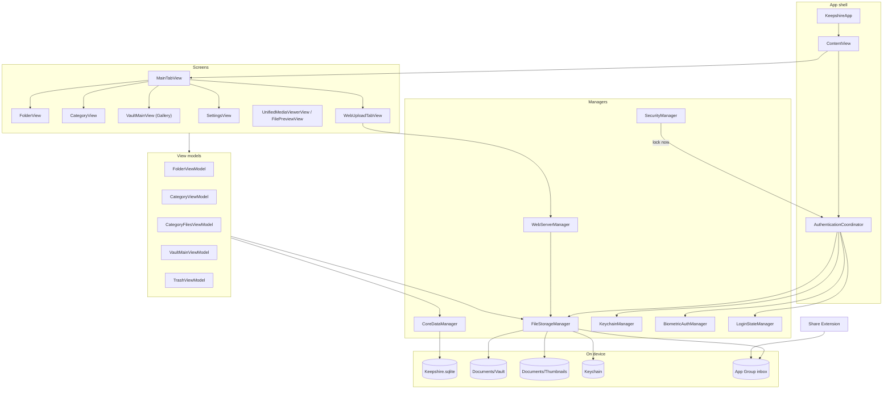
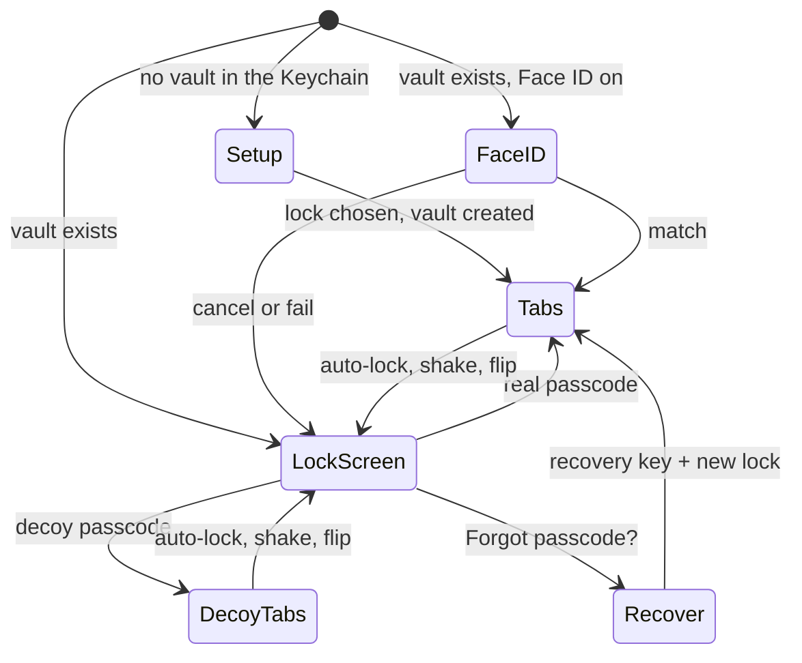
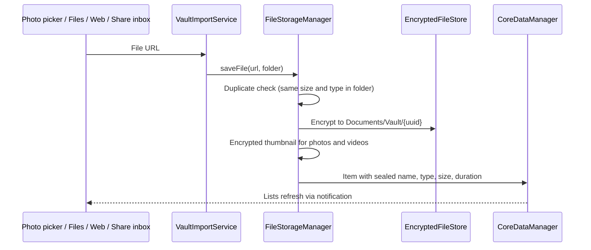
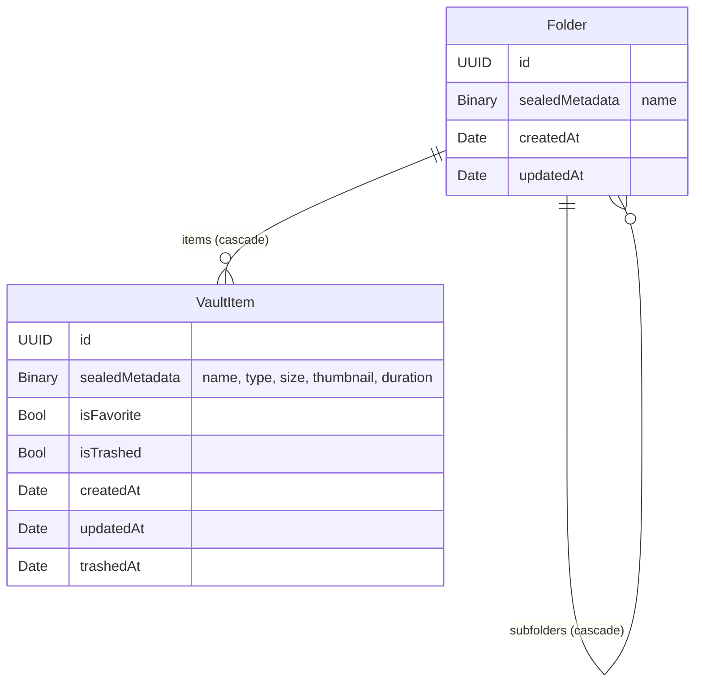

# Architecture

How the app is put together. For the encryption design, see [SECURITY.md](SECURITY.md).

## At a glance

- **SwiftUI** app, **MVVM**, no third-party dependencies.
- **Core Data** holds folder and item records; their names and types are sealed with AES-GCM.
- **Encrypted files on disk**, one UUID-named blob per item.
- **Managers** are the entry points to storage, security, and the web server; focused files behind them do the work.
- A **Share Extension** drops files into an App Group inbox; the app encrypts them after a real unlock.
- One window. Five tabs after unlock: **Folder, Category, Gallery, Web Upload, Settings**.

## Layers



## Folders in the repo

```
Keepshire/
├── KeepshireApp.swift        App entry; first-launch cleanup; UI-test setup (Debug only)
├── ContentView.swift         Chooses setup, lock screen, or tabs
├── Coordinators/             AuthenticationCoordinator: unlock, auto-lock, recovery key offer
├── Dependencies/             Protocols and DependencyContainer
├── Models/                   Core Data classes, sort options, categories, view-model protocols
├── Managers/                 Storage, crypto, Keychain stores, security, web server
├── Services/                 VaultImportService (photo and file import)
├── ViewModels/               One per main screen
├── Views/                    Screens and shared components
└── Utilities/                Keychain, theme and styles, sharing, notification names
KeepshireShare/               Share Extension
KeepshireTests/               Unit tests (Swift Testing)
KeepshireUITests/             UI smoke tests and App Store screenshot capture
release/                      Release scripts, store metadata, marketing assets
web/                          Website: home, privacy, support (Vercel)
```

The Xcode project uses folder-synchronized groups: a new file in these folders is part of the target automatically.

## What the app shows

`ContentView` decides from the coordinator's state:



- **Setup** (`AuthTypeSelectionView`) shows when the Keychain holds no vault, even if a lock type is still saved in settings (as after restoring a backup to a new phone).
- **Recovery key offer** (`RecoveryKeyView`) appears over the tabs after setup, and after unlock until the user declines it.

## Key components

| Component | Responsibility |
|---|---|
| `AuthenticationCoordinator` | Setup vs. lock state, Face ID attempt, auto-lock on return from background, decoy state reset, Share inbox import after unlock, recovery key offer |
| `FileStorageManager` | Public storage API: vault key, unlock, passcode change, recovery key, Face ID copy, saving, loading, sharing, deleting files |
| `VaultCryptoService` | PBKDF2, AES-GCM, wrapping and unwrapping the vault key |
| `VaultKeyDerivationStore` | Keychain reads and writes for the key envelope, Face ID copy, and recovery wrap |
| `EncryptedFileStore` | Reads and writes encrypted blobs, including the chunked `KSHC` format |
| `VaultMetadataSealer` | Seals and reveals names and types in Core Data |
| `ThumbnailGenerationService` | Makes and encrypts 200×200 thumbnails |
| `CoreDataManager` | Folders and items: fetch, move, trash, batch operations |
| `KeychainManager` | Keychain and settings access: lock type, auto-lock, decoy, lockout state |
| `UnlockThrottle` | Wrong-guess lockout shared by the lock screen, Change Authentication, and recovery |
| `SecurityManager` | Screenshot blanking, recording cover, shake and flip to lock |
| `WebServerManager` | LAN HTTPS server, pairing, uploads, downloads |
| `VaultImportService` | Imports from the photo picker and Files |
| `LoginStateManager` | Real vs. decoy session and what each may do |

## Importing a file



Name clashes become `name (n).ext`. Video duration is read at import.

## Dependency injection

`DependencyContainer.shared` supplies production types; tests use `DependencyContainer.createForTesting(...)` and fakes in `KeepshireTests/TestSupport.swift`. Some views still use the managers' `.shared` instances directly.

| Protocol | Production type |
|---|---|
| `CoreDataManaging` | `CoreDataManager` |
| `FileStorageManaging` | `FileStorageManager` |
| `VaultImportServicing` | `VaultImportService` |
| `KeychainManaging` | `KeychainManager` |
| `BiometricAuthManaging` | `BiometricAuthManager` |
| `LoginStateManaging` | `LoginStateManager` |
| `SecurityManaging` | `SecurityManager` |
| `WebServerManaging` | `WebServerManager` |
| `AppDataManaging` | `AppDataManager` |

## App-wide notifications

Defined in `Utilities/AppNotificationNames.swift`.

| Notification | Sent by | Effect |
|---|---|---|
| Tab change | `MainTabView` | Clears multi-select on every list |
| Vault data changed / refresh items | Storage, Core Data, imports | Lists reload |
| Upload progress and completion | `WebServerManager` | Progress cards and banners |
| Trigger security lock | `SecurityManager` | Coordinator locks the vault |

## Data model



- `Folder.parent` and `VaultItem.folder` use **nullify**; an item with no folder is at the root.
- `fileName`, `fileType`, `fileSize`, `durationSeconds`, and folder `name` are empty at rest and filled in memory after unlock.
- Store name `Keepshire`; class code generation is manual (`Folder+CoreData*`, `VaultItem+CoreData*`).
- `save()` throws rather than crashing; a store that fails to load shows an error screen at launch.

## Share Extension

The extension copies shared files into `group.dev.haresh.keepshire/Inbox/<session>/`. It has no access to the vault or the Keychain. The app imports and deletes each session on a real unlock, and when it returns to the foreground still unlocked. A decoy unlock never touches the inbox.

## Settings storage

| UserDefaults key | Meaning |
|---|---|
| `authenticationType` | Lock type, as a fallback to the copy in the passcode wrap |
| `lockTimeout` | Auto-lock seconds (0, 5, 10, 15, 30, 60, 300; -1 = never). Default 30 |
| `biometricEnabled` | Face ID toggle |
| `trashEnabled` | Trash on or off. On after first launch |
| `recoveryKeyOfferDeclined` | User declined the recovery key offer |
| `hasLaunchedBefore` | First-launch cleanup has run |
| `SecurityLogs` | Last 100 security events, not shown in the UI |

On first launch after an install, the app deletes Keychain items and files left by a previous install before any screen appears, because iOS keeps Keychain items across reinstalls.
