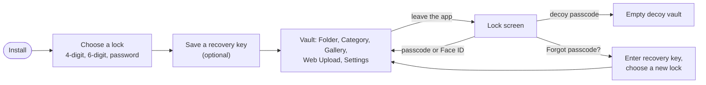
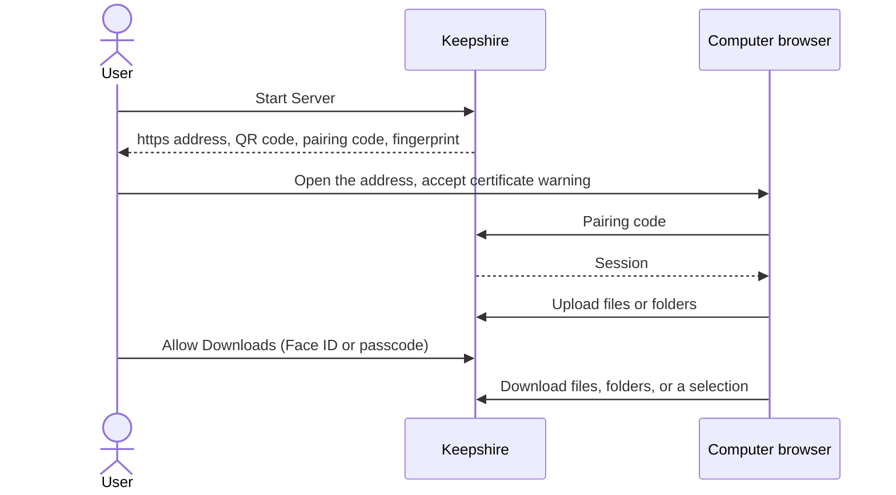

# Features

Everything Keepshire does today. Each row is a behavior that must keep working; [TESTING.md](TESTING.md) has the checks.

## The user journey

## 1. Locking and unlocking

| Feature | Behavior |
|---|---|
| Choose a lock | First launch offers 4-digit passcode, 6-digit passcode (selected, marked Recommended), or password. 4-digit is described as weaker. |
| Passcode setup | Digits only, exact length, entered twice. Code boxes above a custom keypad. |
| Password setup | At least 6 characters, entered twice, with a strength meter. Leading and trailing spaces are trimmed. |
| Unlock | Custom lock screen ("Welcome back"). Passcodes unlock as soon as the last digit is typed. |
| Wrong guesses | 5 free tries, then waits of 30 s, 1 min, 5 min, 15 min, then 1 h. The countdown survives relaunch. |
| Face ID / Touch ID | Optional toggle in Settings. Tried automatically when the lock screen appears; the keypad has a Face ID key. Cancel shows the keypad. |
| Auto-lock | Immediately, 5 s, 10 s, 15 s, 30 s (default), 1 min, 5 min, or Never. |
| App Switcher cover | An opaque branded cover hides the vault whenever the app is not active. |
| Change lock | Settings → Change Authentication: confirm the current credential, pick any lock type, set it. Files are not rewritten; it is instant. |
| Recovery key | 24-character key shown once, confirmed by typing its last 4 characters. Offered after setup and after unlock until declined; managed in Settings → Recovery Key (create a new one, or turn it off). |
| Forgot passcode | Lock screen link, shown when a recovery key exists. Enter the key, choose a new lock, and the vault opens. |

## 2. Decoy vault

| Feature | Behavior |
|---|---|
| Set decoy | Settings → Set Fake Password. Same format as the real lock; must differ from it. Status shows Set / Not Set. |
| Use decoy | Entering it opens an empty vault. |
| Restrictions | No adding files, no folders, no Web Upload. Settings shows About only. No recovery key offer. |
| Change or remove | Settings → Change Fake Password / Remove Fake Password. Changing the real lock removes the decoy and offers to set a new one. |

## 3. Device protections

Settings → Advanced Security.

| Feature | Default | Behavior |
|---|---|---|
| Screenshot protection | On | The vault stays visible on screen; screenshots are blank, including sheets and previews. One alert explains it. |
| Screen recording protection | On | A black cover while the screen is recorded, including after leaving and returning to the app. |
| Shake to lock | Off | A firm shake locks the vault. |
| Flip to lock | Off | Turning the phone face-down locks the vault. |

## 4. Folders

| Feature | Behavior |
|---|---|
| Nested folders | Unlimited depth. Breadcrumbs at the top of the list. |
| Create, rename | From the "…" menu, empty state, or context menu. |
| Move | Folder picker; a folder cannot move into itself or a subfolder. |
| Delete | With trash on, the folder's files move to the trash at the root and folders are removed. With trash off, everything inside is deleted. |
| Swipe to delete | On folder and file rows. Full swipe only when trash is off. |
| Select | Select All, Move, Delete. |
| Search | Matches file names and the names of folders directly inside. |

## 5. Files

| Feature | Behavior |
|---|---|
| Import photos and videos | System photo picker, up to 50 at a time, no photo-library permission needed. |
| Import files | Files app picker, several at once. |
| Share sheet | Share from any app to Keepshire; files arrive on the next unlock. |
| Web Upload | From a computer's browser; see section 9. |
| Duplicates | The same size and type in the same folder is skipped. |
| Name clashes | Renamed to `name (n).ext`. |
| Size limit | 2 GB per file. |
| Thumbnails | Photos and videos; videos show their length. |
| Rename, move, favorite, share, delete | Context menu, viewer, or multi-select. Share decrypts a temporary copy. |
| Sort | Default, Name, Date, Size, Duration, Kind, Favorites; ascending or descending. |
| Search | Gallery, Category lists, and Folders. |
| Multi-select | Long-press or Select; Select All, Favorite, Share, Move, Delete. |

## 6. Gallery and categories

| Feature | Behavior |
|---|---|
| Gallery | Grid of every photo and video, not in the trash. |
| Categories | Favorites, Photos, Videos, Audio, Documents, Other, All Files, with counts. Category lists have no Add button. |

Category matching uses the file's type: **Photos** = any image; **Videos** = mp4, mov, m4v, mkv, avi, webm, flv, wmv, 3gp; **Audio** = mp3, wav, aac; **Documents** = pdf, txt, doc, docx; **Other** = everything else.

## 7. Trash

| Feature | Behavior |
|---|---|
| On/off | Settings → Trash. On by default. |
| View | Settings → View Trash, with a count. |
| Restore, delete forever, empty | Single items or a selection. |
| Turn off with items inside | Asks to "Empty Trash & Disable". |
| Delete with trash off | The file and its thumbnail are removed from disk at once. |

## 8. Viewing

| Feature | Behavior |
|---|---|
| Photos | Swipe between items; pinch, pan, double-tap to zoom. |
| Videos | Autoplay; play/pause, scrubber, ±15 s, speed 0.25×–2×, auto-hiding controls, pinch and double-tap zoom. |
| Audio | Play, pause, seek. |
| Documents | PDFs in the app; plain text in the app; others in Quick Look. |
| File info | Name, type, size, folder, created and modified dates, favorite. |
| Viewer actions | Favorite, Share, Close. |

Files are decrypted to a temporary copy for playback; the copy is removed on lock.

## 9. Web Upload

Move files between a computer and the phone over the same Wi-Fi.

| Feature | Behavior |
|---|---|
| Server | Start/stop in the Web Upload tab (also a sheet from Gallery). Shows `https://<phone IP>:8080`, a QR code, a copy button, and the certificate fingerprint. |
| Pairing | Enter the 6-digit code shown in the app; 5 tries. |
| Browser | Browse folders, upload (button or drag and drop, folders keep their structure), create, rename, delete folders, delete files. |
| Large files | Uploads over 100 MB stream to disk. |
| Downloads | Off until Allow Downloads is confirmed with Face ID or the vault passcode, for 10 minutes. Files, folders (as ZIP), or a selection (`Keepshire Selection.zip`). |
| App in background | An upload already running gets a short time to finish. New uploads need the app open. |
| Phone locked | The browser is told to unlock the iPhone; uploads resume after unlock. |
| Notifications | Permission is asked when the server first starts. In-app banners at 25/50/75/100%; a system notification if the app is not on screen. |
| Decoy | The server cannot start. |

## 10. Settings

| Section | Contents |
|---|---|
| Security | Current method, Change Authentication, Recovery Key, Fake Password, Auto-Lock, Face ID |
| Advanced Security | Screenshot, recording, shake, flip toggles |
| Trash | On/off, View Trash |
| Disk | File count and storage used |
| Lock Behavior | The current auto-lock, restated |
| About | Version and build, Privacy Policy, Support |
| Developer (Debug builds only) | Complete App Reset, Simulate First Launch Cleanup, Delete All Files & Folders |

## 11. Look and accessibility

- Brand palette from the app icon: teal for actions, green for success, red for destructive actions. Light and dark mode.
- VoiceOver labels on the keypad, passcode boxes (progress, not digits), rows, viewer, trash, Web Upload, and player controls.
- Dynamic Type, including the keypad, with 44-point targets.
- iPhone portrait and landscape; iPad all orientations with sidebars for Folders, Categories, and Settings. One window only.
- English only.

## Not included

- In-app camera, scanner, or microphone recording
- iCloud or any cloud sync; any account
- Widgets, Live Activities, Siri, App Intents
- Multiple windows
- Optic ID
- Per-file passwords or a second encrypted vault
- Analytics or crash SDKs

## Known limitations

- Some files appear under **Other** instead of Audio or Documents: m4a (saved as `audio/mp4`, which the Audio list does not include), and ogg, flac, xls, xlsx, ppt, pptx, rtf, zip, rar, 7z (saved with a generic type, because the importer has no mapping for them).
- Web Upload needs the app open; iOS suspends the server shortly after the app leaves the screen.
- Restoring a backup to a new phone starts a new empty vault: vault files are excluded from backups and the Keychain does not move between devices.
