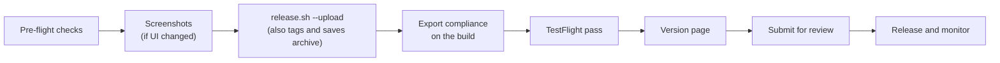

# Release

Ship Keepshire to TestFlight and the App Store. Steps marked **(once)** are only for the first release.

## Release facts

| Field | Value |
|---|---|
| App Store name (30 max) | `Keepshire: Private Photo Vault` |
| Home screen name | `Keepshire` |
| Subtitle (30 max) | `Hide photos, videos & files` |
| Keywords | `gallery,locker,album,encrypted,passcode,secure,folder,document,audio,secret,lock,hidden,pdf,pin` |
| Bundle IDs | `dev.haresh.keepshire`, `dev.haresh.keepshire.share` |
| App Group | `group.dev.haresh.keepshire` |
| Team | `AYL8H487NP` |
| Minimum iOS | 18.5; iPhone and iPad |
| SKU / language | `keepshire` / English (U.S.) |
| Categories | Utilities / Photo & Video |
| Price | Free, no in-app purchases |
| Age rating | 4+ |
| Privacy label | Data Not Collected |
| URLs | Privacy https://keepshire.haresh.dev/privacy · Support https://keepshire.haresh.dev/support · Marketing https://keepshire.haresh.dev |
| Support email | hello@haresh.dev |
| Copyright | `2026 Haresh Godhani` |
| Store handle | @keepshire |

The website lives in [`web/`](../web/) and deploys on Vercel (root directory `web`).

## What is in `release/`

| Path | Purpose |
|---|---|
| `release/release.sh` | Runs unit tests, archives Release, exports an `.ipa` or uploads; after an upload, tags the commit and saves the archive |
| `release/ExportOptions.plist` | App Store export settings (automatic signing, symbols uploaded) |
| `release/screenshots.sh` | Captures screenshots on a 6.9" iPhone and a 13" iPad simulator |
| `release/app-preview.sh` | Records and encodes the app preview videos (needs `ffmpeg`) |
| `release/tools/sample-photos.swift` | Generates 12 license-free sample photos for screenshots |
| `release/tools/marketing-assets.swift` | Builds captioned screenshots, product page header, search image |
| `release/screenshots/` | Raw captures |
| `release/assets/` | Upload-ready screenshots, previews, header, search image |
| `release/metadata/` | Listing text and App Review notes (`fastlane deliver` layout) |

## Release flow



## 1. Account and identifiers (once)

1. Enroll in the [Apple Developer Program](https://developer.apple.com/programs/) as an **Individual**; wait for **Active**.
2. App Store Connect → Business: accept the **Free Apps** agreement. Tax and bank details are only needed for paid apps.
3. Xcode → Settings → Accounts: add the Apple ID; team `AYL8H487NP` appears.
4. [Identifiers](https://developer.apple.com/account/resources/identifiers/list):
   - App Group `group.dev.haresh.keepshire`.
   - App ID `dev.haresh.keepshire` ("Keepshire") with App Groups → that group.
   - App ID `dev.haresh.keepshire.share` ("Keepshire Share") with App Groups → that group.
   - Leave Push, iCloud, and Associated Domains off. Local notifications need no capability.

Automatic signing creates certificates and profiles on the first archive.

## 2. App record (once)

1. App Store Connect → Apps → **+** → New App: iOS, the name above, English (U.S.), bundle ID `dev.haresh.keepshire`, SKU `keepshire`, Full Access.
2. App Information: subtitle, privacy URL, categories, content rights "does not contain, show, or access third-party content".
3. Pricing and Availability: Free, all regions (see France under export compliance).

If the name is taken, pick a variant and update `release/metadata/en-US/name.txt`. Never use "FileVault" in the listing.

## 3. Pre-flight checks (every release)

1. On `main`, all changes committed (`release.sh` refuses to upload otherwise).
2. Unit and UI tests pass ([TESTING.md](TESTING.md)).
3. Manual checklist on a physical iPhone, at least: first launch, Face ID, recovery key, Photos and Files import, Share extension, video, Web Upload from a laptop, auto-lock, screenshot blanking, decoy, trash, change lock.
4. Settings → About opens the live privacy and support pages.
5. Store text matches the app (listing, review notes, website).

## 4. Screenshots

Only exact pixel sizes are accepted.

| Slot | Required | Size | Files |
|---|---|---|---|
| iPhone, Dynamic Island, medium | Yes | 1206 × 2622 | `release/assets/screenshots/iphone-6.3/` |
| iPhone, Dynamic Island, large | No | 1320 × 2868 | `release/assets/screenshots/iphone-6.9/` |
| iPad 13" | Yes | 2064 × 2752 | `release/assets/screenshots/ipad-13/` |

```bash
release/screenshots.sh
```

```bash
swift release/tools/marketing-assets.swift .
```

```bash
release/app-preview.sh
```

- `screenshots.sh` erases the simulators, stages sample photos in the Share inbox, sets a 9:41 status bar, and runs `AppStoreScreenshotTests`, which turns Screenshot Protection off and back on. Seven captures per device: lock, gallery, viewer, folders, categories, Web Upload, settings. Override devices with `IPHONE_SIM=… IPAD_SIM=…`.
- `marketing-assets.swift` builds the captioned screenshots (edit captions at the top of the file), the product page header (3840 × 1646), and the search image (3840 × 2560). Upload these, not the raw captures.
- `app-preview.sh` records unlock → folders → gallery → photo → Web Upload → folders and encodes iPhone (886 × 1920) and iPad (1200 × 1600) previews: 30 fps H.264, 11 Mbps, silent AAC, 15–30 s. Use `IPHONE_SIM=skip` or `IPAD_SIM=skip` for one device. If the runner sits on the Home Screen for minutes, stop and rerun.
- Manual captures: turn off Screenshot Protection (and Screen Recording Protection for video) first, and back on afterwards.

Upload in App Store Connect → the version → Previews and Screenshots: the preview first, then screenshots in order, per slot. The header and search image go in the Asset Library.

The app icon is a 1024 × 1024 PNG without alpha, with dark and tinted variants. There is no layered Icon Composer icon and there are no In-App Event cards.

## Website requirements

The privacy page must state: no account, analytics, ads, tracking, or sale of data; files, metadata, credentials, and settings stay on the device; Face ID is evaluated by iOS and the app never receives biometric data; Web Upload is optional, local-network only, uploads need pairing and downloads need an unlocked export session, and the browser should check the shown certificate fingerprint; screenshot blanking and the decoy are UI protections, not protection against a compromised device; how to get support and how policy changes are announced.

The support page must give a contact method, the supported iOS version, help for unlocking, the recovery key, and the Web Upload certificate warning, and say that without the passcode and the recovery key the files cannot be recovered.

Before spending on marketing, check the name against Apple's trademark list, the App Store, and a trademark register; a trademark attorney can protect it.

## 5. Archive and upload

```bash
release/release.sh 1.0 1 --upload
```

This does, in order:

1. Checks the working tree has no uncommitted changes and that tag `v<version>-<build>` is unused locally and on `origin`. It stops before building if either fails.
2. Runs the unit tests (`SKIP_TESTS=1` skips them).
3. Archives both targets with the same version and build.
4. Uploads with the Xcode Apple ID.
5. Tags the built commit `v<version>-<build>` (annotated) and pushes the tag to `origin`. If the push fails, it prints the command to retry; the upload stands.
6. Copies the archive to `~/Library/Developer/Xcode/Archives/<date>/`, so the Organizer keeps its dSYMs for crash reports. `build/` is git-ignored.

Without `--upload`, it writes `build/release/<version>-<build>/export/Keepshire.ipa` for Transporter. After uploading that file, tag the same build:

```bash
release/release.sh 1.0 1 --tag
```

`--tag` tags the commit that was built, even if you have committed since. A build made with uncommitted changes cannot be tagged.

Without an Xcode login (CI), use an App Store Connect API key (role App Manager); keep the `.p8` out of the repo:

```bash
ASC_KEY_ID=XXXXXXXXXX ASC_ISSUER_ID=xxxxxxxx-xxxx-xxxx-xxxx-xxxxxxxxxxxx ASC_KEY_PATH=~/keys/AuthKey_XXXXXXXXXX.p8 release/release.sh 1.0 1 --upload
```

In Xcode instead: scheme Keepshire, Any iOS Device, same version and build on **both** targets, Product → Archive, Validate, then Distribute → App Store Connect → Upload.

Processing takes 5–30 minutes. A build number can never be reused for the same version.

## 6. Export compliance

Keepshire encrypts files with AES-GCM, so it uses encryption. `Info.plist` does **not** set `ITSAppUsesNonExemptEncryption`: setting it to `YES` without an approved code makes the upload fail ("Invalid Export Compliance Code"), and setting it to `NO` would be false.

Each build shows **Missing Compliance** in TestFlight. Answer:

| Question | Answer |
|---|---|
| Uses encryption | Yes |
| Proprietary or non-standard algorithms | No: AES-GCM (CryptoKit), PBKDF2-HMAC-SHA256 (CommonCrypto), ECDSA and TLS 1.2+ (Security, Network) |
| Own implementation instead of Apple's | No; all crypto is Apple frameworks |
| Purpose | Protecting the user's own files on the device; HTTPS for the local transfer server |

If asked for documentation, provide it (for U.S. mass-market software, typically an annual self-classification report to BIS by 1 February). France may require a separate declaration; provide it or exclude France. If Apple issues a code, add `ITSAppUsesNonExemptEncryption = YES` **and** `ITSEncryptionExportComplianceCode` together. This is not legal advice.

## 7. App Privacy and age rating

- **App Privacy:** "Do you collect data?" → **No**. Accurate because there is no account, analytics, ads, or server; files and settings never leave the device; Web Upload is the user's own browser to their own phone; MetricKit data stays on the device.
- **Age rating:** every content descriptor None; unrestricted web access No (Web Upload is a local server, not a browser); user-generated content No; messaging No; advertising No; parental controls No. Result: **4+**.

## 8. Version page

| Field | Source |
|---|---|
| Promotional text (170) | `release/metadata/en-US/promotional_text.txt` |
| Description (4000) | `release/metadata/en-US/description.txt` |
| Keywords (100 bytes) | `release/metadata/en-US/keywords.txt` |
| Support / Marketing URL | `release/metadata/en-US/support_url.txt`, `marketing_url.txt` |
| Copyright | `release/metadata/copyright.txt` |
| What's New (from 1.0.1) | `release/metadata/en-US/release_notes.txt` |

- **Build:** the processed build.
- **App Review Information:** sign-in required No; your name, phone, hello@haresh.dev; notes from `release/metadata/review_information/notes.txt`.
- **Release:** Manually release this version for the first launch. Phased release is optional for updates.

## 9. TestFlight

Create an internal group, add the build, install on an iPhone and iPad, and repeat the pre-flight flows on that exact binary. External testers need Beta App Review with the same notes.

## 10. Submit for review

Add for Review → Submit. Review usually takes 24–48 hours. With manual release, press **Release This Version** when ready.

| Topic | Likely concern | Answer |
|---|---|---|
| Web Upload | Why a server runs on the phone | Local network only, opt-in, HTTPS, paired by code |
| Certificate warning | Looks like a flaw | The certificate is made on the device each session; its fingerprint is shown in the app |
| Decoy passcode | Deception (2.3 / 5.1) | Opens an empty view of the same app; does not imitate another app or hide the icon |
| Screenshot blanking | Private API | Uses the public `UITextField.isSecureTextEntry` layer |
| "Vault" name | Confusion with FileVault | The listing never says FileVault |
| Forgotten passcode | Data loss | The optional recovery key is the only way back; the app and support page say so |
| Metadata (2.3.7) | Keyword stuffing | No brand names in keywords |

Reply to rejections in Resolution Center: code fixes need a new build number; metadata fixes are edited and resubmitted.

### "Guideline 2.1 – Information Needed"

New accounts often get this: Apple wants a screen recording and written answers. Paste `release/metadata/review_information/notes.txt` as the reply and into the review notes.

Record on a **physical iPhone, latest iOS**, one take of 2–3 minutes that **starts at app launch**:

1. Before recording: install the build, set a 6-digit passcode, turn off **Screen Recording Protection** (Settings → Advanced Security), leave the vault empty, force-quit.
2. Start recording, tap Keepshire on the Home Screen, unlock.
3. Add 3–4 photos from the photo picker.
4. Folder tab: create a folder, move a photo into it.
5. Gallery: open a photo, zoom, double-tap, swipe, close.
6. Category: Photos, then All Files.
7. Add a PDF from Files and open it.
8. Web Upload: Start Server; show the address, pairing code, fingerprint.
9. Settings: Auto-Lock, Face ID, Change Authentication, Recovery Key, Set Fake Password, Screenshot Protection, Trash.
10. Go Home, wait past auto-lock, come back, unlock, stop recording.

Turn Screen Recording Protection back on. Attach the video, then resubmit the newest build.

## 11. After release

`release.sh` has already tagged the build and saved its archive. Watch Xcode → Organizer → Crashes and Ratings and Reviews in the first week.

## Shipping an update

1. Fix, test, and update the affected docs.
2. Next version (`1.0.1` fixes, `1.1` features); build numbers only need to rise within a version.
3. Update `release_notes.txt`; rerun screenshots if the UI changed.
4. App Store Connect → **+ Version** → enter it.
5. `release/release.sh <version> <build> --upload`, then sections 6–11. Privacy, age rating, and export answers carry over unless those areas changed.

## Troubleshooting

| Problem | Fix |
|---|---|
| `No profiles for 'dev.haresh.keepshire.share'` | Register the extension App ID with App Groups, archive again |
| Profile lacks the application-groups entitlement | Assign the App Group to both App IDs |
| Bundle version must be higher | Increase the build number |
| Extension `CFBundleVersion` does not match the app | Use `release.sh`, or set the same version and build on both targets |
| `ITMS-91053: Missing API declaration` | Add the named reason to `PrivacyInfo.xcprivacy` |
| `ITMS-90683` | A usage description is missing from Info.plist |
| `ITMS-90474` / iPad orientation error | Keep all four iPad orientations |
| "Missing Compliance" in TestFlight | Expected; answer the export questions |
| "Invalid Export Compliance Code" | Remove `ITSAppUsesNonExemptEncryption`, or add the code Apple issued |
| `screenshots.sh` finds no simulator | Create it in Devices and Simulators, or pass `IPHONE_SIM` / `IPAD_SIM` |
| "No staged photos were imported" | Run the whole script, not the test alone |
| Black screenshots or previews | Screenshot or Screen Recording Protection was on |
| Upload authentication error | Sign in again in Xcode, or use an API key |
| "Commit or stash your changes first" | The release tag must match the built source; commit, then run again |
| "Tag v… already exists" | That build number was already released; use a new one |
| "Could not push v…" | The upload succeeded; run `git push origin v<version>-<build>` when online |
