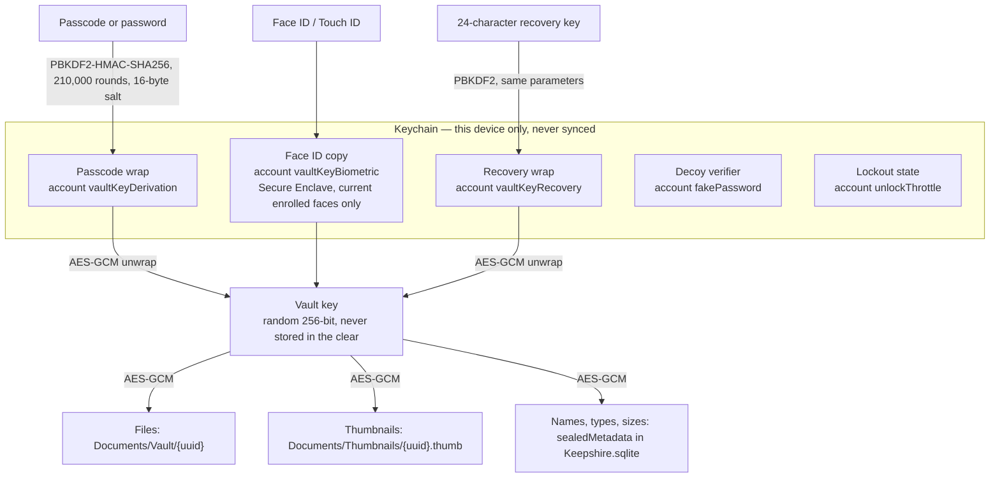
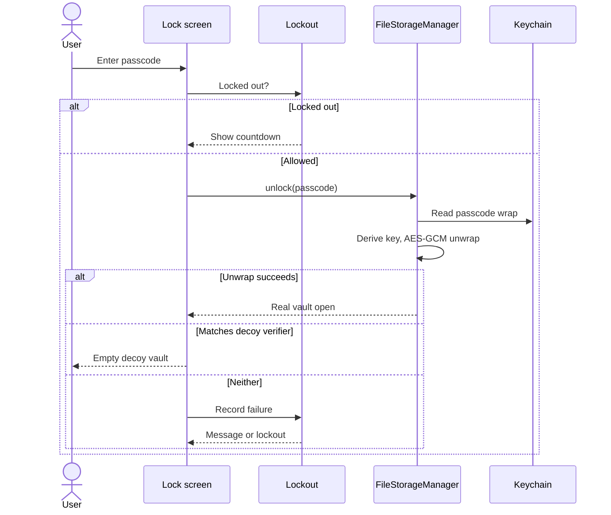
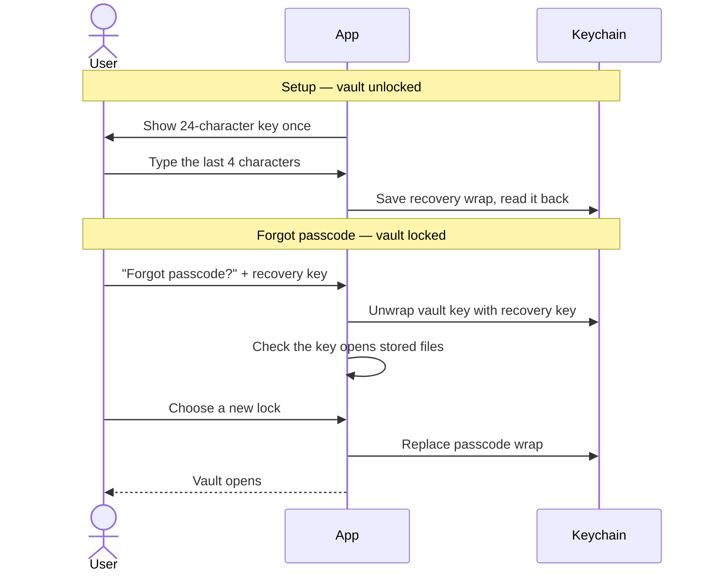

# Security model

How Keepshire protects files, what it defends against, and what it does not.

## In one paragraph

Every file, thumbnail, and file name is encrypted with **AES-GCM** under one random **vault key**. The vault key is never stored in the clear. The Keychain only holds copies of it that are locked ("wrapped") by something the user has: the passcode, Face ID, or a recovery key. Nothing leaves the device, and the passcode itself is never stored.

## What it protects against

| Threat | Protection |
|---|---|
| Someone picks up the unlocked phone and opens the app | Passcode, password, or Face ID; auto-lock (default 30 s); App Switcher cover |
| Someone guesses the passcode | Lockout grows after 5 wrong tries (30 s → 1 min → 5 min → 15 min → 1 h); the lockout survives relaunch |
| Someone reads the app's files from a backup or a copied disk | Files, thumbnails, and metadata are ciphertext; vault folders and the database are excluded from iCloud and computer backups |
| Someone forces the user to open the app | Decoy passcode opens an empty vault |
| A screenshot or screen recording leaks the vault | Screenshots come out blank; a black cover hides the app while the screen is recorded |
| Someone on the Wi-Fi uses Web Upload | HTTPS, a pairing code with 5 attempts, and downloads only after Face ID or the passcode |

## What it does **not** protect against

- A jailbroken or compromised device, or malware running as the user.
- Someone who watches the user type the passcode.
- A 4-digit passcode is only 10,000 combinations; the lockout slows guessing but a 6-digit passcode or a password is stronger.
- The decoy hides files in the app's UI only. The encrypted files are still on disk.
- Blank screenshots are not impossible screenshots: a second camera still works.
- If the passcode **and** the recovery key are both lost, the files cannot be opened by anyone.

## Keys

- **Vault key.** Created once, when the vault is created. It never changes, so no file is ever re-encrypted.
- **Passcode wrap.** The vault key sealed with a key derived from the passcode. It also records the lock type (4-digit, 6-digit, password), so the keypad always matches the credential. A wrong passcode fails AES-GCM authentication; it never yields a wrong key.
- **Face ID copy.** Stored behind `biometryCurrentSet`: the Secure Enclave releases it only after a match, and iOS deletes it if faces or fingers are added or removed.
- **Recovery wrap.** The vault key sealed with the recovery key. Kept in its own Keychain item, so changing the passcode never removes it.
- **Decoy verifier.** A PBKDF2 digest of the decoy passcode. It opens nothing.

All Keychain items use service `dev.haresh.keepshire` and `kSecAttrAccessibleWhenUnlockedThisDeviceOnly`.

## Unlock

A successful unlock resets the lockout. Face ID unlock asks the Secure Enclave for the Face ID copy, then checks that the key opens what is stored before using it.

## Changing the passcode

The app verifies the current passcode, wraps the **same** vault key under the new one, and replaces the passcode wrap in a single Keychain update. It reads the new wrap back before reporting success. After a failure or crash, exactly one credential opens the vault. Files, the Face ID copy, and the recovery key are untouched.

## Recovery key

- **Format.** 24 characters from Crockford base32 (`0-9`, `A-Z` without I, L, O, U): 120 random bits, shown as six groups of four. When typing, case, spaces, and dashes are ignored, and O, I, L are read as 0, 1, 1.
- **Saved only after confirmation.** The key is stored only after the user types its last group, so a key nobody wrote down never becomes the way in.
- **One key at a time.** Creating a new key makes the old one stop working. Turning it off deletes the wrap.
- **Rate-limited.** Wrong keys count toward the same lockout as wrong passcodes. A key of the wrong length is rejected before it counts as a guess.
- **Copy and share.** Copying puts the key on this device's pasteboard only, and it expires after 2 minutes.
- **Decoy.** The decoy session never sees, offers, or changes the recovery key.
- **Stale keys.** Creating a new vault deletes any recovery wrap left in the Keychain by an earlier install.

## Storage

| Location | Contents | iOS protection | Encrypted by Keepshire |
|---|---|---|---|
| `Documents/Vault/{uuid}` | File contents | `complete` | Yes. Files under 16 MB are one AES-GCM box. Larger files use the `KSHC` chunked format (1 MB chunks) so they never sit in memory whole. Imports over 2 GB are rejected. |
| `Documents/Thumbnails/{uuid}.thumb` | 200×200 JPEG previews | `complete` | Yes |
| `Documents/Keepshire.sqlite` | Folders and items | `completeUntilFirstUserAuthentication` | Names, MIME types, sizes, and durations are sealed JSON in `sealedMetadata`; the plain columns are empty at rest |
| Keychain | Wraps, decoy verifier, lockout state, Web Upload TLS key | `WhenUnlockedThisDeviceOnly` | iOS Keychain |
| UserDefaults | Settings only (lock type, auto-lock, toggles) | Standard | No secrets |
| `tmp/keepshire-share/<session>/` | Decrypted copies for Share and preview | Standard | Deleted when the share sheet closes, when the vault locks, and on the next unlock |

File names on disk are UUIDs, not display names. Decrypted names live only in memory after unlock. Decrypted thumbnails are cached in memory and cleared on lock.

## Decoy vault

The decoy passcode opens an empty view of the same app. File lists, folders, categories, and trash are empty; adding files, creating folders, and Web Upload are blocked (the server answers 403); Settings shows About only. It is a disguise of the UI, not a second encrypted vault.

The decoy must differ from the real credential. Changing the lock in Settings removes it (the user is offered to set a new one). Recovering with the recovery key removes it only if the new lock has a different type or equals the decoy.

## Older vaults

Vaults created by earlier builds open without any user action:

- **Passcode-derived key.** If the Keychain holds only a PBKDF2 salt (no wrap), the derived key becomes the vault key and is wrapped on the next unlock. Files are not rewritten.
- **SHA-256 key.** If files exist but the Keychain has no key material, unlock tries the legacy SHA-256 key and adopts it the same way.
- **Plaintext leftovers.** Unlock seals plaintext names into `sealedMetadata`, encrypts plaintext thumbnails, moves files named after their display name to UUID names, and deletes files that no item owns.

A key is only adopted after it opens stored data. An unreadable Keychain is never treated as empty, so a locked Keychain can never cause a new key to be minted over existing files.

## Device protections

| Protection | Default | How it works |
|---|---|---|
| Screenshot blanking | On | The app window is drawn inside a secure text-field layer, so iOS renders it blank in screenshots, including sheets and previews. One alert explains the blank image. |
| App Switcher cover | Always | An opaque branded cover replaces the vault while the app is inactive. |
| Screen recording cover | On | A black window covers the app while the screen is captured. |
| Shake to lock | Off | Accelerometer magnitude above 2.5 locks the vault. |
| Flip to lock | Off | Turning the phone face-down locks the vault. |

## Web Upload

| Control | Detail |
|---|---|
| Transport | HTTPS on port 8080 (TLS 1.2+). Each server start creates a new ECDSA P-256 self-signed certificate; its SHA-256 fingerprint is shown in the app. The private key is deleted when the server stops. |
| Pairing | The browser must enter the 6-digit code shown in the app. 5 attempts per server session. |
| Session | `HttpOnly`, `SameSite=Strict`, `Secure` cookie. Every route except `POST /pair` needs it. |
| Downloads | Off until Face ID or the vault credential opens a 10-minute export session. Each download uses a single-use ticket valid for 60 seconds. |
| Device locked | Routes that touch vault files answer 503 and any export session ends. |
| Decoy | Server cannot start; every route answers 403. |

## Privacy

No account, no analytics, no ads, no tracking, no third-party SDKs. Diagnostics use MetricKit and record only the delivery date. The App Store privacy label is **Data Not Collected**.
